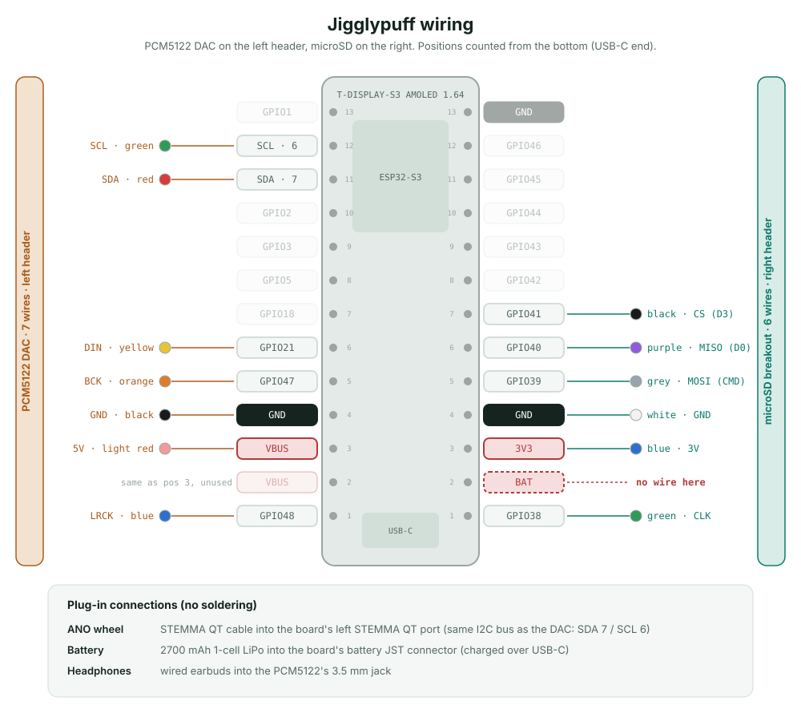

# 8 · Bill of Materials + Wiring

Everything needed to build the console, how it's wired, and the case files.

## Bill of materials

| # | Part | Qty | What it does |
|---|---|---|---|
| 1 | LilyGo **T-Display-S3-AMOLED-1.64** | 1 | The brain and screen: ESP32-S3, 1.64" AMOLED with touch, battery charger (SY6970), USB-C. |
| 2 | Adafruit **microSD breakout** (3V-only SPI/SDIO) | 1 | Holds the music. Wired to the right header. |
| 3 | Adafruit **ANO rotary encoder** + STEMMA QT adapter board | 1 | The click wheel: scroll ring, 4 arrows and a centre Select. Plugs in with a STEMMA QT cable. |
| 4 | **128 GB microSD card** | 1 | Song storage (MP3 / WAV / M4A / AAC / FLAC in the root folder). |
| 5 | Waveshare **PCM5122** audio DAC board | 1 | Hi-fi sound out of a 3.5 mm headphone jack. Wired to the left header. |
| 6 | **2700 mAh** single-cell LiPo battery | 1 | Power. Plugs into the board's battery connector and charges over USB-C. |
| 7 | **M2 threaded inserts and screws** | – | Hold the case and the ANO board together. |
| 8 | 3D-printed case (STL files below) | 1 set | Chassis, back panel and bottom cover. |
| 9 | Jumper wires + STEMMA QT cable | 13 + 1 | 7 wires for the DAC, 6 for the SD card, 1 cable for the ANO. |

Wired earbuds plug into the DAC's 3.5 mm jack.

## Case files

| File | Part |
|---|---|
| `Assembly Chassis.stl` | Main body: holds the screen board, ANO and DAC. |
| `Back Panel.stl` | Back cover. |
| `Bottom Cover.stl` | Bottom cap. |

## Wiring

Positions are counted from the **bottom** of each header (the USB-C end). Each
header has **13** pins.

**Left header → PCM5122 DAC (7 wires)**

| Pos | Board pin | Wire | DAC pin |
|---|---|---|---|
| 1 | GPIO48 | blue | LRCK |
| 2 | VBUS | – | *empty (same as pos 3)* |
| 3 | VBUS | light red | 5V |
| 4 | GND | black | GND |
| 5 | GPIO47 | orange | BCK |
| 6 | GPIO21 | yellow | DIN |
| 11 | GPIO7 (SDA) | red | SDA |
| 12 | GPIO6 (SCL) | green | SCL |

**Right header → microSD (6 wires)**

| Pos | Board pin | Wire | SD pin |
|---|---|---|---|
| 1 | GPIO38 | green | CLK |
| 2 | BAT | – | ***must stay empty*** (raw battery voltage) |
| 3 | 3V3 | blue | 3V |
| 4 | GND | white | GND |
| 5 | GPIO39 | grey | CMD (MOSI) |
| 6 | GPIO40 | purple | D0 (MISO) |
| 7 | GPIO41 | black | D3 (CS) |

**Plugged in, no soldering:** the ANO goes into the left STEMMA QT port (it shares
the I²C bus with the DAC at a different address); the battery goes into the
battery connector.

**Things to know**
- The DAC needs **5 V**, which only exists on VBUS. On battery the firmware turns on
  the charger's 5 V boost while music plays, so it works unplugged too.
- The SD breakout is 3 V only: power it from **3V3**, never VBUS or BAT.
- Leave the SD card's `DET` pin unconnected.
- The firmware's pin numbers are in `3_Music_App/SdConfig.h` and
  `3_Music_App/AudioConfig.h`. They must match the wiring.

`wiring-diagram.html` is the same diagram as an interactive page with a dark mode.
Download it and open it in a browser.
