# 4 · Games

Opening **Games** shows a tile per game, nine in all, three on screen at a time
(scroll with the wheel or Left/Right). Every picture in play is drawn from
shapes and every sound synthesised, so the games need no image or audio files
(only the storybook cards use a few public-domain engravings). `HalfRes.*` is
shared by most of them: they draw at half resolution and it doubles the pixels
on the way to the screen. *Lamplighter* draws at full resolution instead.

In every game, holding **Select** for about a second quits straight to Home,
whatever the game is doing.

## *Gaslight & Griffins*

A 3D detective RPG in a gaslamp world where everyone raises partner creatures. You play Wren Ashby, apprentice to Professor Vane, who "fell" at Calder Falls a year ago.

There are four towns, each built on an old myth, and each town's crime echoes its myth:

| Town | Myth | Case |
|---|---|---|
| Fogmouth | the *Odyssey* | *The Drowned Choir* |
| Sandmere | the *Book of the Dead* | *The Featherless Scale* |
| Greenwold | *Sir Gawain and the Green Knight* | *A Year and a Day* |
| Skjold | Odin's ravens | *Thought and Memory* |

They all lead to the Collector in Ur-Lumen and the *Epic of Gilgamesh*. There are four endings, and which one you get depends on whether you named the right people, the favours you earned from the myth beings, Juno's trust, and the 20 story pages you found.

**Being a detective**
- **Clues** go in a casebook.
- **The deduction board:** pin two clues together. A wrong link costs composure.
- **Skill checks:** roll 2d6 plus Observation, Logic, Memory, Charm, Disguise or Lore. The odds are shown before you choose.
- **Interrogations** are a weighing: show the clue that breaks a lie.
- **Accusations** name who, why, how and the proof. Get it wrong and the case changes for the worse.

**Battles** are turn-based, with:
- a team of six, four moves each
- nine types and a type chart
- status effects, catching with lanterns, levels and new forms
- trainers on the road, a Warden in each town, a rival, and legendaries

There are 62 species. A small trained model gives every wild creature its own colouring. Another, trained on the game's own lines, writes crowd chatter, rumours and street kids' gossip in the background.

**The Wilds.** A signpost at the edge of each town leads into open country that is different on every visit. A third trained model lays it out tile by tile: dunes and gorse on the coast, palm-ringed oases in the desert, thick groves and ponds in the forest, crags and meltwater on the fjord, canals and ruined walls round Ur-Lumen. A trail runs through it. Caches hide along the way, and at the far end a ring of standing stones holds an elder creature.

**Music.** Eleven original pieces: one for each town, the Wilds, battles and bosses, mysteries and interrogations, the Falls, and a victory fanfare. A small tracker on the console plays them with synthesised instruments under the sound effects.

**Controls**
- **Arrows:** walk (relative to the camera).
- **Wheel:** turn the camera round Wren.
- **Touch:** drag sideways to turn, drag up or down to zoom in close.
- **Centre:** talk, examine, confirm. On empty ground it opens the menu, which also has the camera's close/far switch.
- **Down:** back, in menus.

It draws at full resolution in 3D on both cores. Each place's ground is painted into a texture when you arrive. The myth scene cards use public-domain engravings; see [`Gaslight/CREDITS.md`](Gaslight/CREDITS.md). The design is in [`Gaslight/DESIGN.md`](Gaslight/DESIGN.md) and the technical plan in [`Gaslight/TECH.md`](Gaslight/TECH.md).

| File | What's in it |
|---|---|
| `Gaslight/Gaslight.*` | Entry points, frame loop, strip renderer on both cores, title, save |
| `Gaslight/R3D.cpp` | Meshes, camera, per-strip rasteriser with depth, the ground plane |
| `Gaslight/World.cpp`, `GroundTex.cpp` | Tile maps to 3D, painted ground, walking, doors, people, camera control |
| `Gaslight/Areas.cpp`, `Towns.cpp` | Fogmouth by hand; the other towns generated by `tools/make_towns.py` |
| `Gaslight/Script.cpp`, `Story*.cpp` | The story language and the story itself, one file per town |
| `Gaslight/UI.cpp` | Casebook, deduction board, interrogation, accusation, team, bag |
| `Gaslight/Battle.cpp`, `Dex.cpp` | Battles, the type chart, moves, 62 species, trainers |
| `Gaslight/Art.cpp`, `Cards.cpp` | People and creatures in 3D, portraits, scene cards |
| `Gaslight/TextModel.cpp` | The chatter model, run on the second core when it's free |
| `Gaslight/Wilds.cpp`, `GLTiles.h` | The land model and the Wilds it writes (trained by `tools/worldmodel/train_tiles.py`) |
| `Gaslight/Tune.cpp`, `GLMusic.h` | The music tracker and the score (written by `tools/make_music.py`) |
| `Gaslight/Bot.cpp` | PC simulator only: a playtest bot that plays the story through the real keys |

## *White Heron*

A 3D flight over four lands. Each year people light paper lanterns and let them
go, each one a wish; the white heron gathers them on her way home. Fly her
through the rings of wind that keep her aloft, collect the lanterns, and never
touch water or land.

  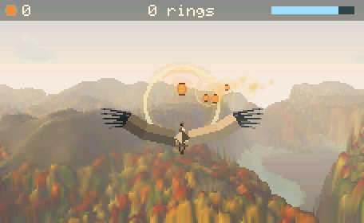
  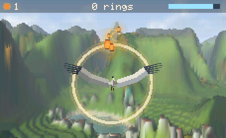

  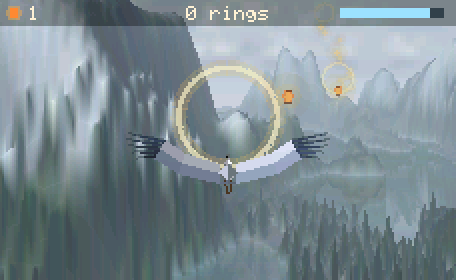
  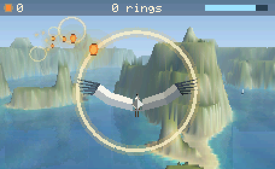

**Four worlds**, each a procedural seed with its own land, plants, buildings,
light and air. Pick one with Left/Right on the title screen; each is made fresh
when you fly it (about 11-13 s on the console).

| World | What's there |
|---|---|
| **Maple Hollow** | Rolling hills of orange, red and gold tree crowns, ponds, a winding dirt path, soft hazy light. |
| **River Citadel** | A river winding through green meadows, a town of pale houses with a few green domes along its banks, a white fortress on the highest hill, cumulus in a blue sky. |
| **Snow Lake** | A large still lake that mirrors the peaks, snow lying where the slopes let it, dark snow-dusted conifers, poplar rows on the shore, low mist, painted boats. |
| **White Cliffs** | Stepped limestone islands with layered cliff faces, beaches, turquoise shallows over sand fading to deep blue, white sails. |

  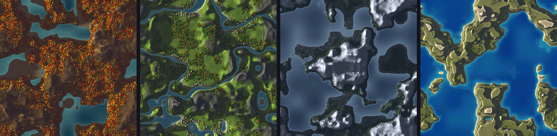

**The heron** is a jointed mesh: each wing has a shoulder, elbow and wrist, pale
coverts at the front and grey secondaries behind, a white wrist patch and five
dark primaries fanned like fingers. The neck folds back in an S, with a black
crown stripe and an orange bill, and the legs trail behind. Slow, deep
wingbeats bend each wing at the elbow and wrist and fold it a little on the
upstroke; she beats faster as she climbs.

**Making a world** (in `Crane.cpp`; about 2 MB of PSRAM while it runs):
- **Land:** an island mask from fractal noise, rolling hills plus ridged
  multifractal mountains, blurred so the slopes are smooth, then remapped so a
  set share of the map lies under water. White Cliffs is terraced into plateaus,
  `h' = (floor t + smoothstep(0.7, 1, frac t)) * step`. River Citadel carves a
  river where `|fbm - 0.5|` is small; Maple Hollow lays a path the same way.
- **Things on it:** trees are stamped into the heightmap as domes (or cones for
  conifers and poplars) on a jittered grid, so they have real crowns that catch
  the light and cast shadows. Houses and the fortress are blocks with pale walls
  round the edge and dark roofs inside.
- **Light:** a sweep along each row toward the sun keeps a horizon height,
  `hs = max(hs - tan(elevation), h)`, and anything below it is in shadow. Then
  Lambert shading from the slopes, ambient occlusion from a 13 x 13 local mean,
  sunlight tinted the sun's colour and shadow tinted the world's shade colour,
  rock on steep ground and snow only where the slope lets it lie.
- **Distance:** two averaged copies of the map (256 and 128 square) for the far
  ground, so it doesn't alias into stripes.

**Drawing a frame:**
- **Terrain:** a heightmap ray-caster. All screen columns step out together,
  depth by depth, so neighbouring columns read neighbouring texels. Each sample
  blends the four texels around it in fixed point, height and colour at once,
  and shades its span down to the nearer sample, so cliffs read as surfaces.
  Both cores share the work: the second core draws the left half of the screen
  while the first draws the right.
- **Air:** haze `F = 1 - exp(-k z / zfar)` toward the world's haze colour, and
  mist that lies low over the water, `m = mist * exp(-(h - sea) / 16)`.
- **Water:** ripples from a tiling noise table, sun glints, and screen-space
  reflections that mirror the shore, the mountains and the sky, wavering with
  the ripples and stronger toward the distance.
- **Sky:** a gradient, the sun, and a band of clouds painted from noise, lit on
  top and shaded underneath.
- **In the air:** the wind rings, lanterns and boats are hidden where nearer
  land covers them, using a depth buffer the terrain fills.

It runs at about 14-15 fps on the console.

| File | What it does |
|---|---|
| `Crane.*` | *White Heron*: the four worlds and their generator, the ray-caster and its two-core split, sky, haze, mist and reflections, wind rings, lanterns, boats, the heron, flight, and the title and story cards. |

**How to play**: **Left/Right** (or the wheel) turn, and the heron banks into
the turn. **Up** climbs, **Down** dives. Each ring she flies through gives back
wind (the bar at top right) and a little speed; lanterns give a little wind
too. With no wind left she can only glide down. **Select** pauses. On the title
screen, Left/Right chooses the world. Each world remembers its best number of
wishes. The USB bench command `Z` (with the game open) starts an autopilot, and
each further `Z` makes and flies the next world.

## *Lamplighter*

An endless gravity-hopping flight through space. The Hush, a tide of quiet
dark, is putting the stars to sleep. Wren keeps the lamps of the sky, and her
little ship, the Moth, has no fuel left: only the pull of worlds. Catch a
world's gravity and swing around it, let go to fly off along the orbit, and
every world she circles lights its lamp again (a lighthouse beam starts to
sweep from it; a sleeping star blazes back to life).

  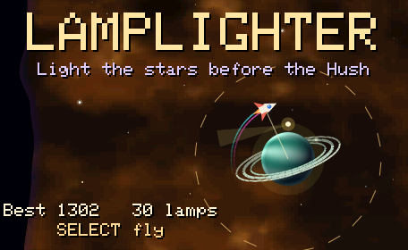
  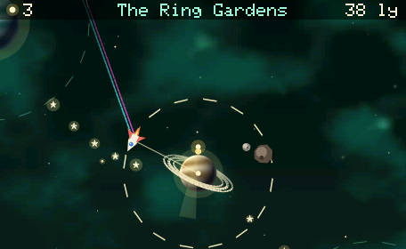
  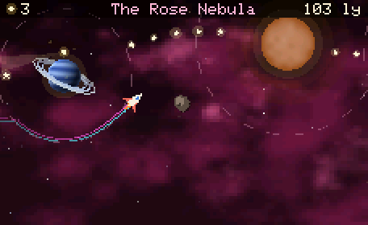

  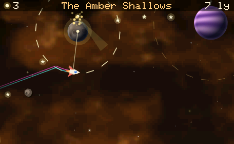
  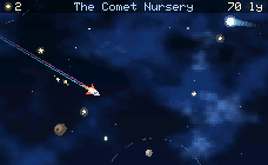
  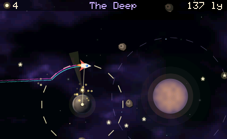

- **Gravity:** inside a world's field (the dashed ring) its pull bends the
  path, `a = k v^2 r / d^2` toward the centre. It scales with the speed
  squared, so a world bends the path into the same shapes however fast the
  Moth goes. Only her direction changes; her speed is fixed and rises slowly
  with distance.
- **Orbit:** holding locks a circular orbit at the distance where she caught
  it, turning at `v / r`, the way set by which side she came in on. Letting go
  flies on along the tangent. The wheel moves the orbit in or out.
- **Danger:** touching a world, a moon (some worlds have one circling inside
  the field) or a rock ends the run; so does the Hush. It creeps at half her
  speed when close and rushes in when left far behind, so lingering in an
  orbit costs ground.
- **Five regions**, each with its own nebula and kinds of world: the Amber
  Shallows (rock and lava worlds), the Ring Gardens (ringed giants), the Comet
  Nursery (comets streak across), the Rose Nebula (stars to wake) and the
  Deep (dark stars with a much stronger pull). Then round again, faster.
- **Score:** 25 a lamp, 5 a speck of stardust, plus the distance in
  light-years. The best score is remembered.

**The drawing:** each world is shaded per pixel: `z = sqrt(1 - d^2)` on the
disc, Lambert light `max(0, n.L)` from the upper left, surface detail (gas
bands, craters, ice caps, glowing lava cracks) read at a longitude
`u = dx / (z + 0.35) + spin` so it turns, and a rim of atmosphere. The
nebulae are two layers of fractal value noise, made seamless left to right
by `T(x) = ((w - x) f(x) + x f(x - w)) / w`. Rings and accretion discs draw
their far half before the world and the near half after it.

**Full resolution on two cores:** the frame is drawn at the screen's full
456x280, in 14 strips of 20 rows, never as a whole frame (it wouldn't fit in
fast memory). Every shape is drawn with smooth edges: a pixel a shape's edge
crosses is blended by how much of it the shape covers, and the worlds' limbs
by how far inside them each pixel centre lies, `(1 - d) R + 1/2`. The nebula
is sampled bilinearly, so it stays soft. The second core draws the odd strips
while this one draws the even ones and sends them to the panel, so a strip
goes out while the next is being drawn.

| File | What it does |
|---|---|
| `Lamplighter.*` | The flight, gravity and orbits, the five regions, worlds, moons, rocks, comets, stardust, the Hush, and the title and story cards. |

**How to play**: **hold any arrow** (or hold the screen) to catch the nearest
world's pull and orbit it; let go to fly. The **wheel** steers a little, or
moves the orbit in and out. **Select** pauses. The USB bench command `Z` (with
the game open) starts an autopilot, and each further `Z` starts it in the next
region.

## *Ariadne's Thread*

  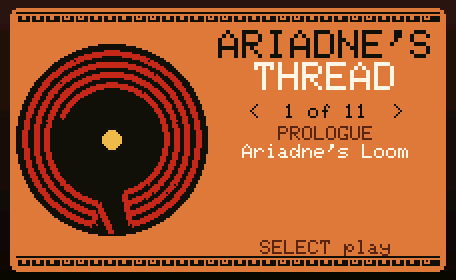
  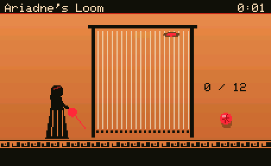
  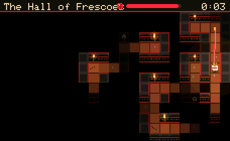

  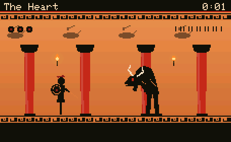
  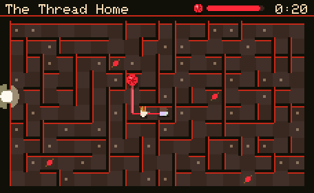

The myth of the Cretan labyrinth in ten levels, drawn like Greek black-figure
pottery (clay orange, glossy black figures with incised details, Greek-key
bands) and Knossos frescoes (red columns that taper downward, double axes,
dolphins, lilies, horns of consecration). The labyrinth itself is black and red.

| # | Level | What you do |
|---|---|---|
| Prologue | Ariadne's Loom | Press Select as the shuttle crosses the gold. Each true throw spins more thread for Act I. |
| Act I, 1-4 | The Bull Gate, The Hall of Frescoes, Daedalus's Doors, The Breathing Dark | Theseus walks a torch-lit maze, unrolling the red thread behind him. Walk back along it to wind it in; if it runs out, wind back and try another way. Double axes mark the true path in the Hall; bronze doors swing open and shut; in the Breathing Dark the Minotaur follows your scent, and you see only his eyes. |
| Act II | The Heart | A vase-painting arena. The Minotaur paws, then charges: leap over him, let him crash into the columns, and strike while he is dazed. The crashes shake stones loose. |
| Act III, 1-4 | The Thread Home, The Flooded Cistern, Minos's Guards, The Last Gate | You are the ball of thread, rolling a path out while Theseus and the Athenians follow. The thread can never cross itself, so a wrong turn means winding back (Select). Spindles add thread; water costs double; lantern light pulls the thread back; the last hall falls on a timer. |
| Finale | The Crown of Stars | Ariadne sails free and the last of her thread becomes Corona Borealis. |

**The generator** (comments in `Ariadne.cpp` give the details):
- **Mazes, Act I:** Wilson's algorithm (loop-erased random walks, so every
  perfect maze is equally likely), then braiding where the probability of
  opening a dead end follows a fractal noise field, `p = p0 (0.55 + 0.9
  max(0, fbm))`. Five candidates are made and scored by
  `F = 0.45 L/2N + 0.25 E/N + 0.20 H/2 + 0.10 (1 - |D - D*|/D*)`: solution
  length L, the cells E an A* agent expands (the agent-effort difficulty
  measure of Beukman, James & Cleghorn, arXiv:2201.10334), the entropy H of the
  junction degrees and the dead-end ratio D. The best is kept.
- **Yarn levels, Act III:** a Hamiltonian path through every cell, shuffled by
  ~3000 backbite moves (Mansfield 1982; shown to connect all Hamiltonian paths
  of a grid by Kazazi, arXiv:2601.06749), gives a long self-avoiding route from
  the centre to the edge. Every other cell is joined to it by Wilson's walks as
  dead-end branches. The thread given is the route's own cost (wet steps
  count double) plus a margin, and guards only patrol halls the route crosses,
  so there is always a moment to slip past.
- **Decoration:** Poisson-disk dart throwing for frescoes, torches and
  spindles; the double axes follow the BFS solution.
- **Light:** `I(d) = (1 - (d/R)^2)^2` with a flicker, only where a Bresenham
  ray reaches the tile; torches make a static light map.
- **The Minotaur:** follows a diffusing scent,
  `u' = u + D (sum of neighbours - n u) - lambda u`, with u = 1 at Theseus.
- **The thread:** drawn as a Catmull-Rom curve through the tile centres.
- **The title:** the classical seven-circuit Cretan labyrinth from the coins of
  Knossos, drawn as its path (circuits 3 2 1 4 7 6 5, then the centre).

| File | What it does |
|---|---|
| `Ariadne.*` | All ten levels, the generators, lighting, the Minotaur, the black-figure characters and the story cards. |

**How to play**: arrows walk or steer (the wheel steers the yarn and walks
Theseus in the arena; hold Down to walk down). **Select** throws the shuttle,
leaps or strikes, winds the yarn back, and pauses in the mazes. Steering the
ball back the way it came stops it, to wait for a guard to pass. **Down**
pauses in the arena; **hold Down** pauses at the loom and in the yarn halls.

**Every level is checked by self-play**: the USB bench command `Y` (with the game
open) has a bot play each level 12 times on fresh labyrinths, with the least
thread the loom can give, and prints wins, losses and times.

## *Cat Nap*

  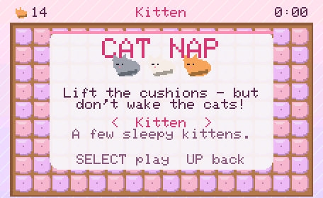
  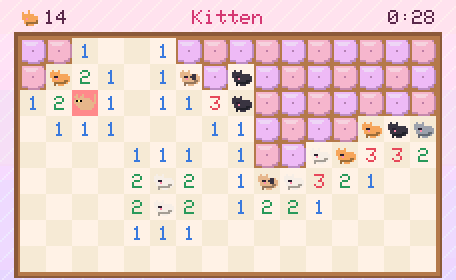

Mini mines, with cats. Cats are asleep under some of the cushions; lift all the
others without waking any. A number tells how many cats sleep on the cushions
around it. Mark a cat's cushion with a ball of yarn. The first cushion is never a
cat, and an empty one opens its whole quiet patch. Three households: **Kitten**
(14 cats), **Cat cafe** (22) and **Cat lady** (30), on a 16 x 9 board. Best
times are remembered.

| File | What it does |
|---|---|
| `CatNap.*` | The board, the cushions, the sleeping (and one very awake) cats, yarn marks, the timer and best times. |

**How to play**: arrows move the paw, **Select** lifts the cushion, and turning the
wheel puts yarn on or takes it off. Select on a number whose cats are all marked
lifts the rest around it. **Hold Down** to pause. Tapping a cushion lifts it.

## *Raise the Emerald City*

  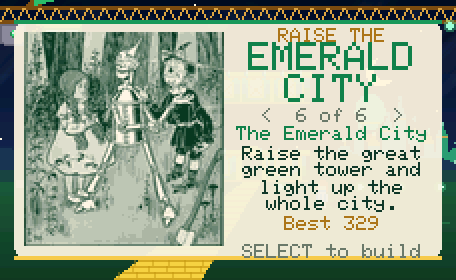
  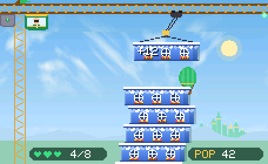
  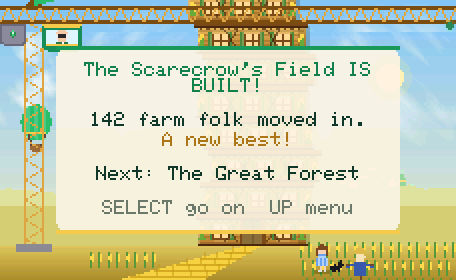

  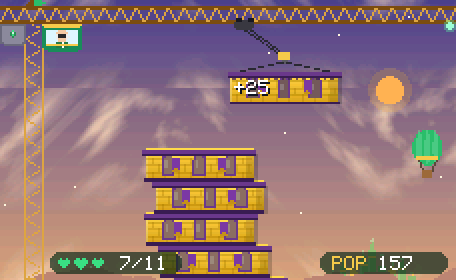
  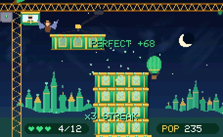
  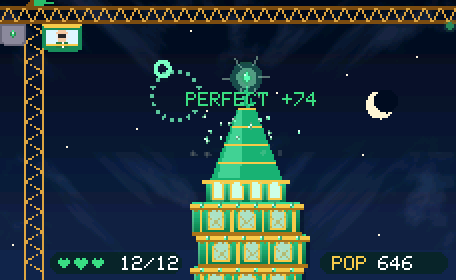

A tower-stacking game from *The Wonderful Wizard of Oz* (L. Frank Baum, 1900).
The cyclone scattered the Emerald City, and the Wizard runs a brass crane to
build it again. Each floor swings from the crane's hook. Drop it square onto the
one below: the better it lines up, the more people move in.

- **Perfect drop:** it snaps into place, sparkles, and counts double. Three in a
  row bring the **Winged Monkeys** with 25 more people.
- **Sloppy drop:** the tower leans and starts to sway, which makes the next drop
  harder.
- **Hearts:** a floor that misses the edge falls, and so does one that tips the
  tower too far off balance. Each costs one of three hearts.
- **Roof:** after the last floor comes the roof. Then the camera glides down the
  finished tower as every window lights up.

Six lands, each with its own floors, roof and twist:

| # | Land | Floors and roof | Twist |
|---|---|---|---|
| 1 | Munchkin Country | blue, with scalloped awnings and round windows; a blue dome | none: learn the swing |
| 2 | The Scarecrow's Field | a wooden barn with green shutters and corn cobs; thatch with a crow weathervane | the Witch's crows land on the swinging floor and rock it |
| 3 | The Great Forest | riveted tin with portholes and the Tin Woodman's heart; a tin cone with a heart weathervane | heavy floors: slow swing, more sway |
| 4 | The Poppy Field | cream with red arches and poppy window boxes; a red onion dome | the crane grows drowsy, then wakes |
| 5 | The Winkie Country | yellow stone with purple banners; battlements and a purple turret | the west wind pushes the crane and the falling floor |
| 6 | The Emerald City | emerald glass, gold pilasters and gems, at night; the great green spire | fast, with a breeze |

Dorothy and Toto wait at the foot of the Yellow Brick Road, the Wizard sits in
the crane's cab, his green silk balloon drifts by, and the Emerald City glints on
the horizon until you reach it. Finishing a land unlocks the next; each land's
best population is remembered. The ending card shows how many people came home
to Oz.

| File | What it does |
|---|---|
| `EmeraldCity.*` | The crane, the six lands (floors, roofs, scenery, skies with Perlin-noise clouds), the swing and drop, balance and sway, scoring, and the story cards. |
| `Denslow.h` | W. W. Denslow's 1900 illustrations (Dorothy with the Tin Woodman and the Scarecrow; Toto at the Emerald City; the Wizard found out) for the title and story cards. They are public domain, from Wikimedia Commons. Generated by `tools/make_denslow.py`. |

**How to play**: **Select** (or a tap) drops the floor. The wheel nudges the
crane's trolley a little to fine-tune the swing. **Down** pauses. On the title
screen, Left/Right chooses a land.

## *Late for Tea*

  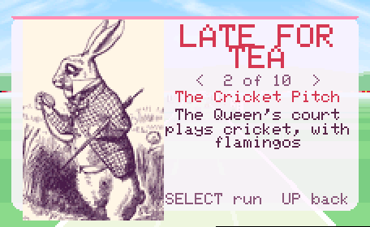
  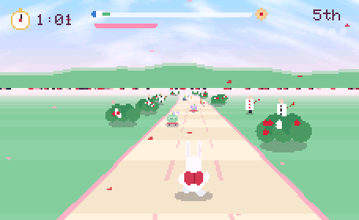
  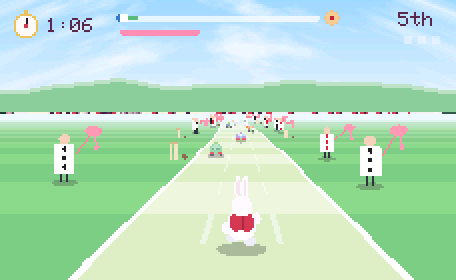

  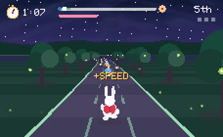
  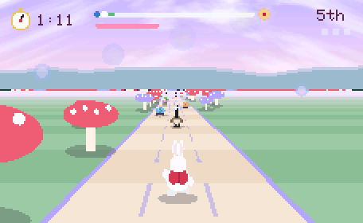
  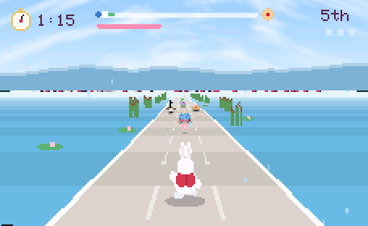

  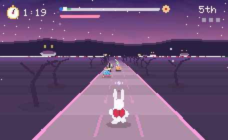
  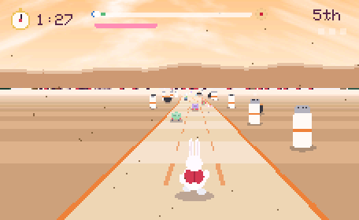
  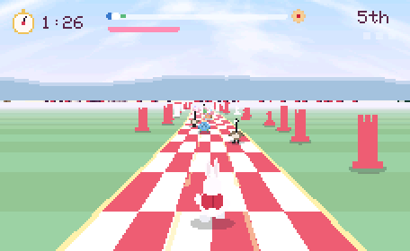

  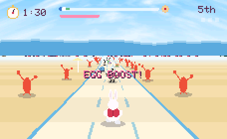
  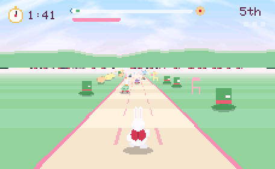

A 3D dash behind the White Rabbit, down winding paths through ten places from
Wonderland, to reach the Mad Hatter and the March Hare's tea party before four
o'clock:

1. The Garden of Roses (white, red, and white painted red)
2. The Cricket Pitch (flamingo bats)
3. The Firefly Forest
4. The Caterpillar's Mushrooms
5. The Pool of Tears
6. The Cheshire Woods
7. The Duchess's Kitchen
8. The Looking-Glass Board
9. The Lobster Quadrille
10. The Mad Tea Party

How it plays:
- **Rivals:** tortoises on skateboards race him for the **Linzer cookies**. If one
  gets there first, they eat them all.
- **Alice:** she chases him. If she catches him three times, she shares the
  cookies with the seagulls, the tortoises and him.
- **Geese:** they block the paths. Hop over them.
- **Boosts:** candy and Easter eggs speed him up.
- **Seagulls:** they swoop down. A **yellow** one carries him ahead, a
  **purple** one carries him back.
- **The clock:** if four o'clock comes first, the Queen is furious.
- **Progress:** winning a place unlocks the next. Win all ten and the cookies
  are his, but he shares them anyway.

| File | What it does |
|---|---|
| `LateForTea.*` | The 3D path (perspective ground, winding curve, scenery both sides), the ten places, the characters (drawn from shapes, inspired by Tenniel), Perlin-noise clouds and hills, the race rules, and the story cards. |
| `Tenniel.h` | John Tenniel's 1865 illustrations (the White Rabbit, the Mad Tea Party, the Queen of Hearts) for the title and story cards. They are public domain, from Wikimedia Commons ("Alice par John Tenniel 02 / 25 / 29.png"). Generated by `tools/make_tenniel.py`. |

**How to play**: **Left/Right** (or the wheel) changes path, **Select** hops,
**hold Up** to sprint (it uses his puff, which refills), and **Down** pauses.
On the title screen, Left/Right chooses a place.

## *Cypress Night*

  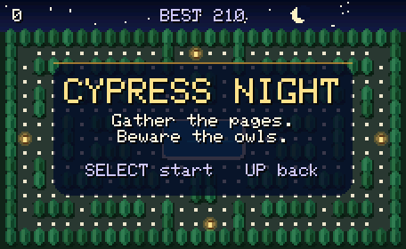
  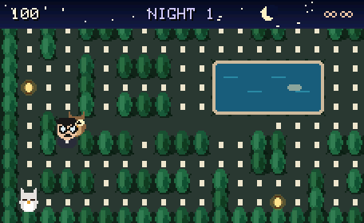

A maze chase in a Persian garden at night. A writer in round glasses gathers
the pages of his manuscript from the paths between rows of cypress trees, around
a central pool. Four owls hunt him from their roosts in the corners and wake one
after another. Each has its own habit: one heads straight for him, one cuts him
off, one circles the pool until he comes near, and one wanders. A **lantern**
dazzles them for a few seconds: they turn pale and flee, and catching one sends
it back to its roost (200, 400, 800, 1600 points). A **pomegranate** appears
below the pool twice a night. Clear every page and dawn breaks; the next night is
faster. Extra life every 10,000 points. Best score is remembered.

| File | What it does |
|---|---|
| `CypressNight.*` | The garden, the writer, the owls and their habits, lanterns, scoring, the title / pause / game-over screens. |

**How to play**: arrows walk. Turning the wheel turns him left or right. Tapping
the screen beside him heads that way. **Select** starts and pauses; while
paused, **Down** quits the run. Up only means "back" on the title screen, since
it walks during play.

## *Lullaby Run*

  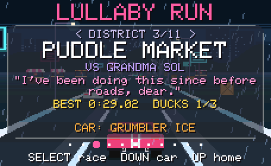
  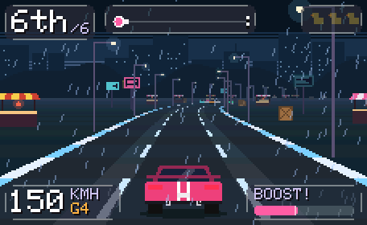

A pseudo-3D arcade racer in 11 districts. Puff races rivals across the city to win
the Golden Hubcap. Every picture is drawn from shapes and every sound is synthesised
while it plays, so the game needs no image or audio files.

| File | What it does |
|---|---|
| `LullabyRun.*` | The game: the 11 districts (colours, skyline, props, rival, track), road and car physics, rivals and traffic, pickups (candy = boost, music note = sends cars to sleep, 3 hidden ducks), the district picker, HUD, pause and finish screens, unlocks and best times. |
| `Raster.*` | A small shape renderer (rectangles, polygons, circles, lines) that draws into the game's frame buffer, or into one strip of it, with optional smooth edges. Each core has its own target. |
| `RunAudio.*` | The engine sound, built live: an **EV** motor whine or a petrol (**ICE**) engine with gears and exhaust pops, plus tyre/wind noise and effects. Streams straight to the DAC. |
| `preview/lullaby-run.html` | The same game in a web browser, used to design the look. Open it in any browser. |

**How to play**: the car accelerates by itself. Steer with the wheel or Left/Right,
**Down** brakes, **Select** boosts, **Up** pauses (then Down quits). Finishing in the
top 3 unlocks the next district. Marshmallow (EV) recharges its boost when braking.
Grumbler (ICE) charges it on near misses.

**Performance**: the game draws at half resolution (228×140) in fast internal memory
and doubles every pixel on the way to the screen, at about 17–20 frames per second.
Music stops while the game is open, because the engine sound uses the DAC.
