

# Jigglypuff

**A handmade pocket music console, built as a gift.**

Your music library on a hi-fi DAC, eight original games, and songs added from your
phone, all in a "liquid glass" theme in Jigglypuff pink.

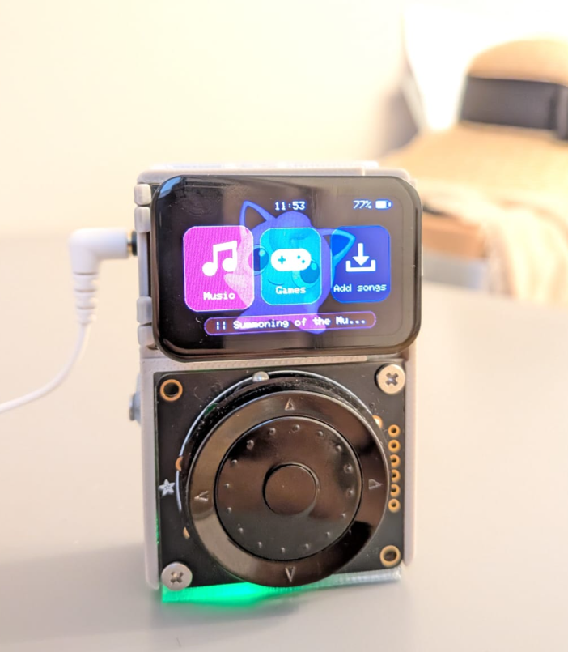&nbsp;&nbsp;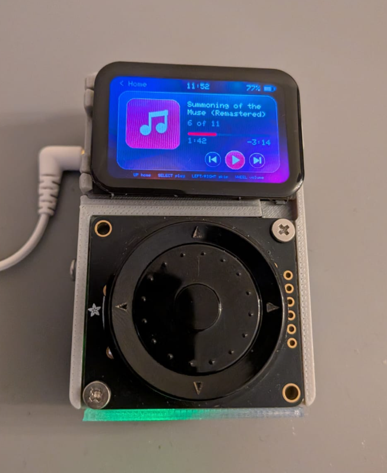

[Music](#music) · [Games](#games) · [Add songs](#add-songs-from-a-phone) · [Flash it](#flashing-it) · [Controls](#controls) · [Hardware](#hardware)

---

## Music

  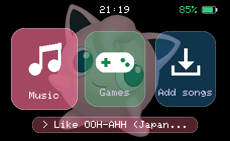
  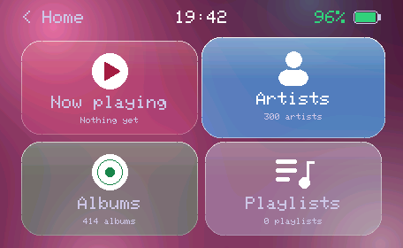
  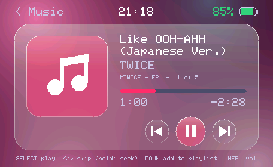

- **Library:** reads every song on the microSD card (MP3, M4A/AAC, FLAC, WAV, in
  any folder) and sorts them by artist, album and playlist, using the tags inside
  each file.
- **Menu:** four tiles, **Now playing / Artists / Albums / Playlists**. Any song
  can be added to a playlist.
- **Player:** tap Left/Right to skip songs, or hold them to scrub through a song.
  The wheel sets the volume.
- **Lock and pick up again:** hold Down to turn the screen off; turn the wheel about 45° to wake it on the same song or list you left.

## Games

Every picture is drawn from shapes and every sound is synthesised live, so the
games need no image or audio files. Hold **Select** for a second in any of them
to go back to Home.

<table>
<tr>
<td width="33%" align="center">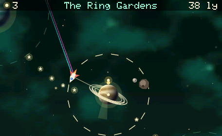 <b>Lamplighter</b> Swing between worlds on their gravity and relight their lamps before the Hush puts the stars to sleep. Endless.</td>
<td width="33%" align="center">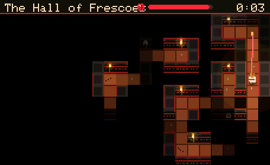 <b>Ariadne's Thread</b> The Cretan labyrinth myth in ten levels, drawn like Greek vase paintings. Every labyrinth is generated fresh.</td>
<td width="33%" align="center">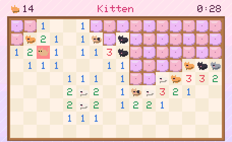 <b>Cat Nap</b> Mini mines, with cats. Lift the cushions without waking the cats asleep underneath.</td>
</tr>
<tr>
<td align="center">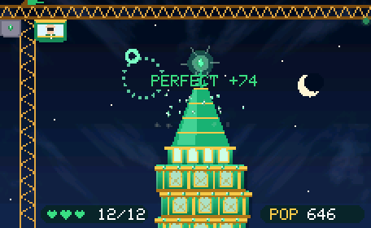 <b>Raise the Emerald City</b> Stack the Wizard's swinging floors square to rebuild Oz, across six lands.</td>
<td align="center">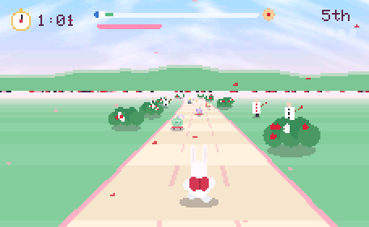 <b>Late for Tea</b> The White Rabbit's 3D dash through ten places in Wonderland, to the Mad Hatter's party by four.</td>
<td align="center">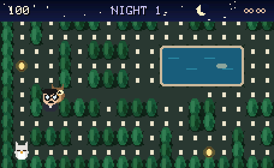 <b>Cypress Night</b> A writer gathers his manuscript in a Persian garden while owls hunt him among the cypresses.</td>
</tr>
<tr>
<td align="center">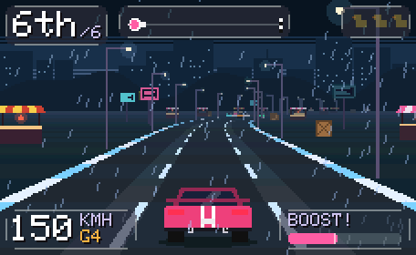 <b>Lullaby Run</b> A night-time city racer across 11 districts, with a live engine sound.</td>
<td align="center">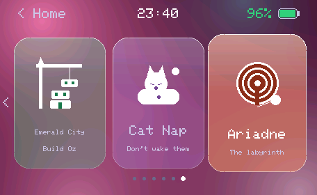 <b>The Games menu</b> Three tiles on screen at a time; scroll with the wheel.</td>
<td align="center">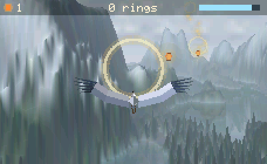 <b>White Heron</b> A 3D flight over four lands, gathering wish lanterns through rings of wind.</td>
</tr>
</table>

**Gaslight & Griffins** is the ninth tile: a 3D detective RPG across four towns built on old myths, with partner creatures, deduction, interrogations and four endings.

Rules, stories, controls and more screenshots for each game are in
[`4_Games/`](4_Games/).

## Add songs from a phone

- **Upload:** open **Add songs** on the console, then go to `jigglypuff.local`
  in a browser. Drop music files on the page and they go straight onto the card.
- **Organize:** `jigglypuff.local/organize` lets you fix missing artists, albums
  and titles, merge or rename artists and albums, build playlists, and play any
  song in the browser while you edit.
- **Auto-tagger:** [`3_Music_App/tools/autotag.py`](3_Music_App/tools/autotag.py)
  looks songs up on MusicBrainz and iTunes and fills in their details.

## Flashing it

1. Plug the console into the PC with a USB-C data cable and switch it on.
2. Double-click **`flash.bat`**.

The script finds PlatformIO and the console's USB port, then builds the firmware
and writes it. You need PlatformIO; the VS Code extension is the easiest way to
get it.

> **Can't connect?** Hold **BOOT**, tap **RST**, release **BOOT**, and run it again.

| Command | What it does |
|---|---|
| `flash.bat` | build and flash, port found automatically |
| `flash.bat -Port COM12` | use a specific port |
| `flash.bat -Monitor` | flash, then show the console's log |
| `flash.bat -BuildOnly` | only check that it compiles |
| `flash.bat -Clean` | rebuild everything from scratch |

## Controls

| Control | Home and menus | Music lists | Now playing |
|---|---|---|---|
| Wheel | choose a tile | scroll | volume |
| Left / Right | choose a tile | page up / down | tap: previous / next song · hold: rewind / fast-forward |
| Select (centre) | open | open / play | play / pause |
| Up | back | back | back to the lists |
| Down | — | on a song: add to playlist | add to playlist |

| Anywhere | |
|---|---|
| **Brightness** | hold **Down** and turn the wheel (remembered; this never locks the screen) |
| **Lock the screen** | hold **Down** about 1 s and let go (any screen outside a game): music keeps playing, buttons and touch do nothing |
| **Wake it** | turn the wheel about 45°; it wakes right where you left it |
| **Quit a game** | hold **Select** about 1 s, from any screen of any game |
| **Power** | hold **Select** about 1.2 s to switch off (from Home or the menus); about 2 s to switch on |
| **Touch** | works too: tap the tiles, the player buttons or "< Home" |

Each game shows its own controls on its title screen.

## Hardware

| Part | |
|---|---|
| **Board** | LilyGo T-Display-S3-AMOLED-1.64: ESP32-S3, 16 MB flash, 8 MB PSRAM, a 280×456 AMOLED used sideways, FT3168 touch, SY6970 charger |
| **Controls** | Adafruit ANO rotary navigation encoder (I²C) |
| **Sound** | Waveshare PCM5122 DAC, for wired earbuds |
| **Storage** | Adafruit microSD breakout and a 128 GB card |
| **Power** | 2700 mAh LiPo battery |
| **Case** | 3D-printed, with M2 inserts and screws |

  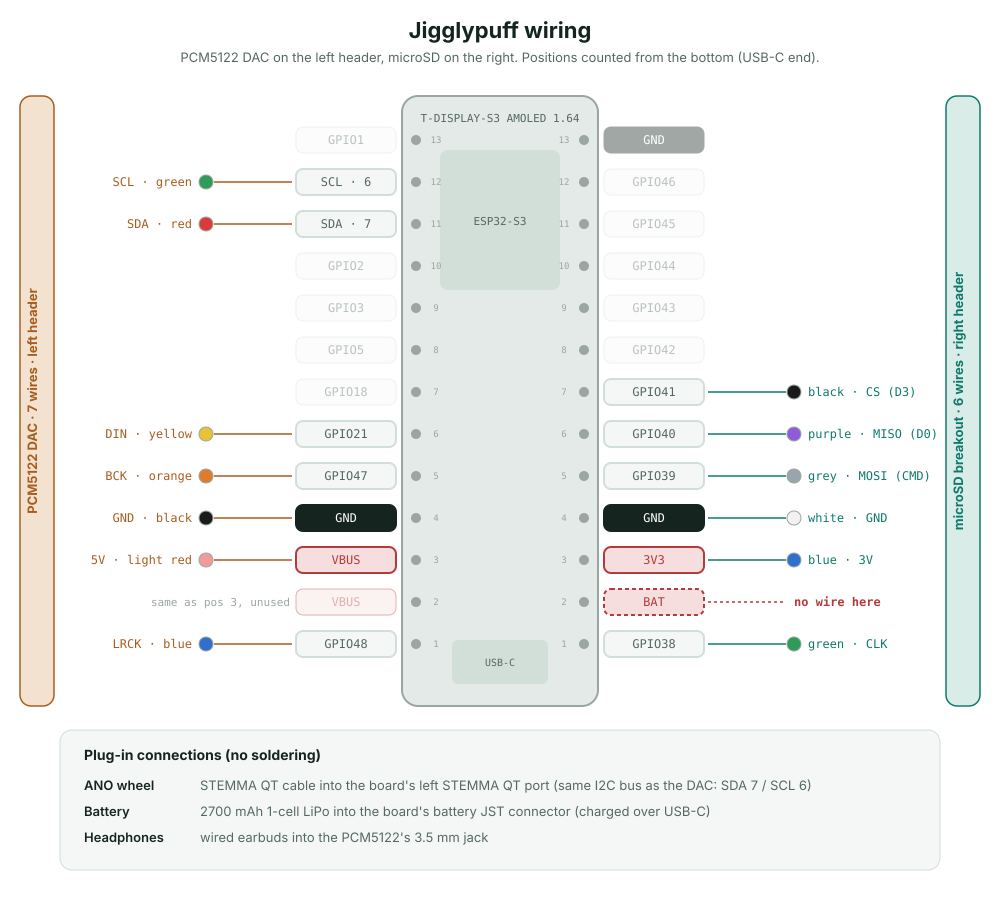

The full parts list, the pin map with wire colours, and the case files (STL) are
in [`08_BOM/`](08_BOM/).

<b>How the repo is laid out</b>

 

| Folder | What's in it |
|---|---|
| [`1_Examples/`](1_Examples/) | LilyGo's original example sketches for the board. Not part of the console. |
| [`2_Firmware/`](2_Firmware/) | The main program: screens, menus, buttons, touch, battery and charger, screen sleep, power off. Plus the board's schematic and datasheets. |
| [`3_Music_App/`](3_Music_App/) | The music library, tag reader, playlists, the Music screens, the player and the PCM5122 DAC driver. Plus the auto-tagger tool. |
| [`4_Games/`](4_Games/) | *Lullaby Run*, *Cypress Night*, *Late for Tea*, *Raise the Emerald City*, *Cat Nap*, *Ariadne's Thread*, *Lamplighter*, *White Heron* and *Gaslight & Griffins*, with their drawing, rules and synthesised sound. |
| [`5_Web_Uploader/`](5_Web_Uploader/) | The phone pages: song upload and the organizer. Also clock sync. |
| [`6_Theme_Graphics/`](6_Theme_Graphics/) | The glass look, the Jigglypuff-pink theme, the landscape screen rotation and the Home artwork. |
| [`07_Images/`](07_Images/) | Photos of the console and screenshots from it. |
| [`08_BOM/`](08_BOM/) | Bill of materials, wiring diagram with wire colours, and the 3D-printable case (STL). |
| `libraries/` | Third-party libraries the build uses: display, touch/charger driver, and the audio decoder (patched; see `3_Music_App`). |
| `boards/` | PlatformIO board definition for the 16 MB ESP32-S3. |
| `platformio.ini` | Build settings; it stitches folders 2–6 into one firmware. |
| `flash.bat`, `flash.ps1` | The flashing script. |

Each folder has its own README explaining its files.

## Credits

- The title and story cards in *Raise the Emerald City* use W. W. Denslow's 1900
  illustrations for *The Wonderful Wizard of Oz*.
- The title and story cards in *Late for Tea* use John Tenniel's 1865
  illustrations for *Alice's Adventures in Wonderland*.

Both are public domain, from Wikimedia Commons.

 
Made with love, one jumper wire at a time.

